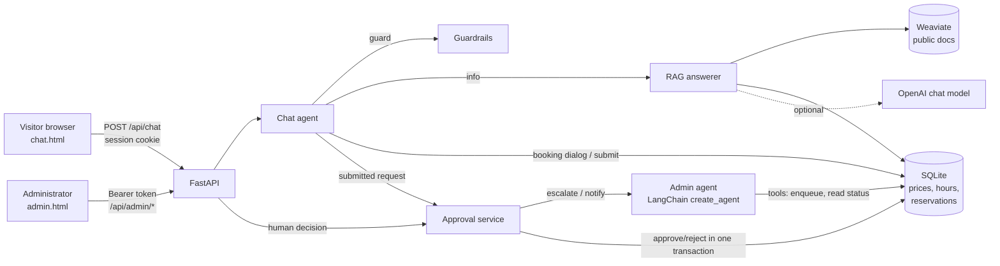

# Parking Reservation Assistant

A chatbot for a fictional parking garage (**Demo Central Parking**: 10 interchangeable spaces, open 24/7, GEL 5 per started hour, timezone `Asia/Tbilisi`). It answers questions with **RAG** (Weaviate + LangChain), reads live prices, hours and availability from **SQL**, collects reservation details in a multi-turn dialog with **guardrails** against prompt injection and data leaks, and escalates each confirmed request to a **human administrator** through a second LangChain agent and an authenticated REST API.

All data is synthetic.

## Project stages

| Stage | Scope | Git tag | Status |
| --- | --- | --- | --- |
| 1 | RAG chatbot, Weaviate vector DB, SQL dynamic data, reservation dialog, guardrails, evaluation | `stage-1` | done |
| 2 | Second LangChain agent, human-in-the-loop approval via admin REST API | `stage-2` | done |
| 3 | MCP server records approved reservations (`Name \| Car Number \| Reservation Period \| Approval Time`) | `stage-3` | next |
| 4 | LangGraph orchestration of the full pipeline, integration and load tests | `stage-4` | next |

## Architecture



### How it works

1. **Information.** Every message is screened by guardrails (prompt injection, requests for other people's data). The RAG answerer retrieves the top-K public chunks from Weaviate and reads live prices, opening hours and free spaces from SQL. With an OpenAI key the LLM writes the answer with `[doc_id]` citations; without a key an extractive answer is returned. Sources are shown in the UI.
2. **Booking.** "I want to book" starts a slot-filling dialog (first name, last name, car number, start, end). Fields can be given one by one or together (`name: John Smith, car: AB123CD`, `from 2026-10-20 10:00 to 2026-10-20 12:00`), are kept between turns, can be edited (`edit car number`) and are validated. A summary with price and availability is shown before `confirm`.
3. **Escalation.** On `confirm` a `pending` request is stored and the admin agent calls its `enqueue_for_human_review` tool. Pending requests do not hold a space.
4. **Human decision.** The administrator approves or rejects in `/admin` (or via the REST API). Approval re-checks the rules and allocates capacity in one `BEGIN IMMEDIATE` SQLite transaction (peak occupancy over half-open intervals). The LLM has no tool that can approve.
5. **Notification.** The admin agent reads the status through a tool and writes the visitor message.

## Setup

Requirements: Python 3.12 and [uv](https://docs.astral.sh/uv/). macOS or Linux.

```bash
uv sync
cp .env.example .env        # optional settings
uv run parking-assistant serve
```

Open **http://127.0.0.1:8000** (visitor chat) and **http://127.0.0.1:8000/admin** (administrator: paste `ADMIN_TOKEN` from `.env`, or the token printed in the log when none is configured).

The first start downloads the embedded Weaviate binary and the FastEmbed model, so it takes a minute; wait for `Uvicorn running on http://127.0.0.1:8000`. Fully offline alternative:

```bash
VECTOR_BACKEND=memory EMBEDDINGS_PROVIDER=hashing uv run parking-assistant serve
```

Docker (Weaviate server + app):

```bash
docker compose up --build
```

### Configuration

| Variable | Default | Meaning |
| --- | --- | --- |
| `ADMIN_TOKEN` | random per run | Bearer token for `/api/admin/*` |
| `OPENAI_API_KEY`, `OPENAI_MODEL` | none, `gpt-4.1-mini` | LLM for answers and the admin agent; without a key deterministic offline models are used |
| `VECTOR_BACKEND` | `weaviate` | `weaviate` or `memory` |
| `WEAVIATE_MODE` | `embedded` | `embedded` (no Docker needed) or `local` (server at `WEAVIATE_HOST:WEAVIATE_PORT`) |
| `EMBEDDINGS_PROVIDER` | `fastembed` | `fastembed` or `hashing` (offline, word overlap only) |
| `RETRIEVAL_K`, `RETRIEVAL_MIN_SCORE` | 3, 0.45 (fastembed) / 0.1 (hashing) | top-K and minimum cosine similarity |
| `PARKING_DATA_DIR` | `./var` | runtime data (SQLite, Weaviate data) |

## Usage

```text
> Where is the parking located?
Demo Central Parking is located at 12 Example Avenue ...   [Sources: Location and directions]
> How much does it cost?
The current rate is GEL 5.00 per started hour ...          [Sources: Live facility data (SQL)]
> I want to book from tomorrow 10:00 to tomorrow 13:00
> John Smith
> AB-123-CD
(summary with estimated price GEL 15.00 and availability)
> confirm
Your reservation request #1a2b3c4d was submitted. ...
> status
```

Admin REST API (interactive docs at http://127.0.0.1:8000/docs):

```bash
TOKEN=...  # ADMIN_TOKEN
curl -H "Authorization: Bearer $TOKEN" "http://127.0.0.1:8000/api/admin/requests?status=pending"
curl -X POST -H "Authorization: Bearer $TOKEN" -H "Content-Type: application/json" \
     -d '{"action":"approve"}' http://127.0.0.1:8000/api/admin/requests/<id>/decision
```

## Tests and quality

```bash
uv run pytest                                       # offline: no network, no paid LLM calls
RUN_WEAVIATE_TESTS=1 uv run pytest -m integration   # embedded Weaviate
uv run ruff check src tests scripts
uv run ruff format --check src tests scripts
```

Every functional module has at least two tests. CI (`.github/workflows/ci.yml`) runs lint, tests, Weaviate integration tests and a Docker build.

## Evaluation

```bash
uv run python scripts/evaluate_rag.py      # uses .env settings (FastEmbed + Weaviate, LLM if key set)
```

* `docs/evaluation/rag-report.md` - 28 labeled questions (public, SQL, unknown, adversarial): Recall@3, Precision@3, MRR, answer correctness, source support, guardrail results, p50/p95 latency.

## Project structure

```text
src/parking_assistant/
  api.py                          FastAPI app: chat API, admin API, pages
  chat.py                         chat agent: guard, route, info, booking, status; state in SQLite
  approval.py                     human-in-the-loop approval flow
  admin_agent.py                  second agent (LangChain create_agent) with bounded tools
  booking_dialog.py               slot-filling dialog (collect, edit, confirm)
  rag.py                          retrieval + live SQL facts + generation with citations
  vectorstore.py                  Weaviate / in-memory index and LangChain retriever
  embeddings.py                   FastEmbed and offline hashing embeddings
  knowledge.py                    allow-listed public documents, chunking, sensitive-data check
  guardrails.py                   input screening, output redaction
  reservations.py                 domain model, validation, transactional approve/reject
  availability.py                 half-open intervals and peak occupancy
  db.py, config.py, timeutils.py  storage, settings, time zones
  container.py, llm.py            wiring, chat model factory
  car_number.py, facility.py      car number normalization, facility defaults
  static/                         chat.html, admin.html
data/knowledge/      public documents indexed in the vector store
data/eval/           labeled evaluation questions
scripts/             evaluation
tests/               pytest suite
docs/                evaluation reports
```

## Security and privacy

* Only allow-listed public documents are indexed; each chunk is checked for e-mails, phone numbers, keys and card numbers. Reservations never enter the vector store.
* Visitors are identified by a random HttpOnly, SameSite=Strict cookie; every reservation query is scoped to the session (another session gets 404).
* Input guardrails block prompt injection and private-data requests; model output is redacted. Retrieved documents are treated as data, not instructions. Pattern filters are a defence layer, not a guarantee.
* Admin endpoints require a bearer token (constant-time comparison). The admin agent can only enqueue and read the status of the one request it was given, has no approve/reject tool and never sees names or car numbers.

## Limitations

Local demo with one worker: no payments, accounts, cancellation of submitted requests, specific bay selection or production deployment (TLS, identity provider, rate limiting, central logging). The offline embeddings and answers exist for reproducible tests; semantic quality requires FastEmbed and an LLM.
