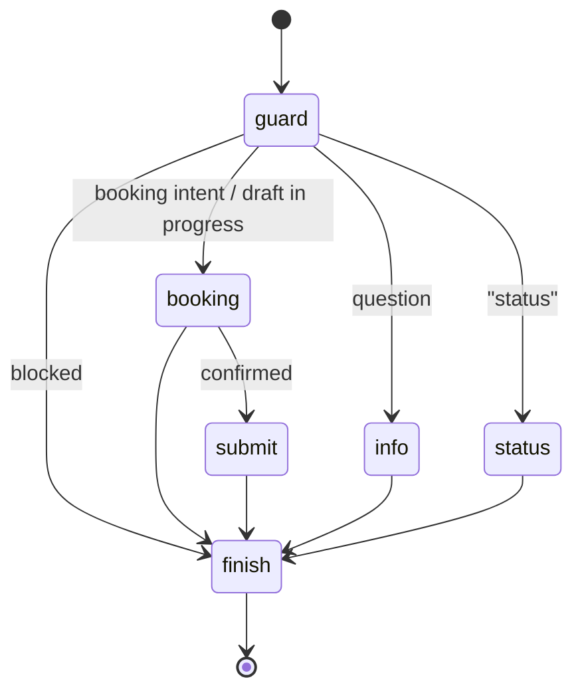
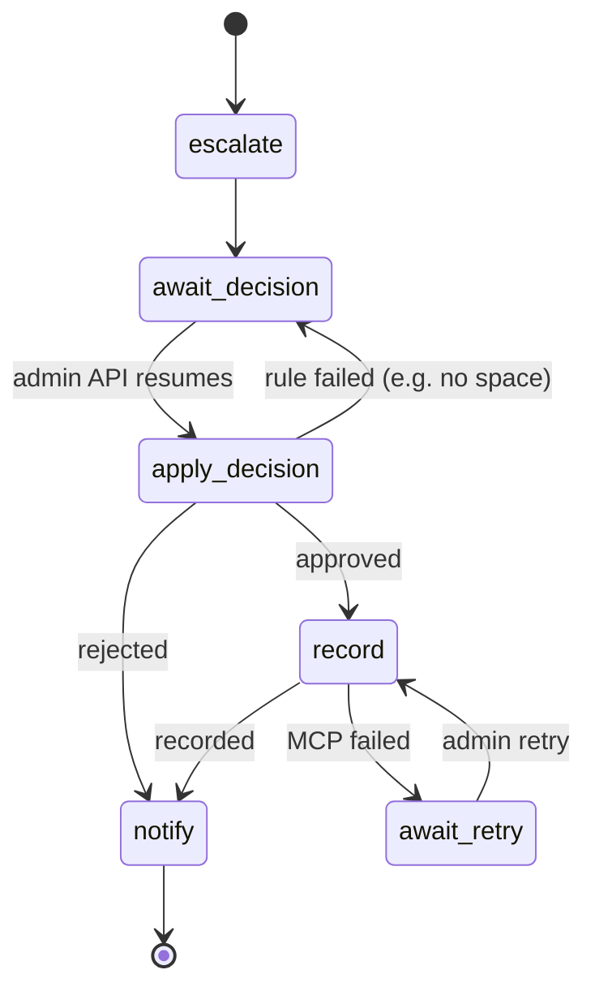

# Architecture

## Components

| Component | Module | Responsibility |
| --- | --- | --- |
| Web API and pages | `api.py`, `static/` | Visitor chat (`/`, `/api/chat`, `/api/my-requests`), admin UI and API (`/admin`, `/api/admin/*`), session cookie, admin bearer auth |
| Chat graph (agent 1) | `graphs.py: ChatGraph` | Per-session LangGraph: guard → route → info / booking / status → submit |
| RAG answerer | `rag.py` | Retriever over Weaviate + live SQL facts → LLM (LCEL chain) or extractive answer; citations; output redaction |
| Knowledge base | `knowledge.py`, `data/knowledge/` | Allow-listed public markdown, split on `##` sections, sensitive-content check before indexing |
| Vector store | `vectorstore.py` | Weaviate collection with self-provided vectors (cosine HNSW); in-memory alternative for tests |
| Booking dialog | `booking_dialog.py` | Deterministic slot filling: collect, validate, edit, cancel, summary, confirm |
| Reservation service | `reservations.py`, `availability.py`, `db.py` | Validation, idempotent submit, transactional approve/reject, peak occupancy, owner-scoped reads |
| Reservation workflow | `graphs.py: ReservationWorkflow` | Per-request LangGraph with human interrupt, MCP recording, retry, notification |
| Admin agent (agent 2) | `admin_agent.py` | LangChain `create_agent` with two bounded tools; offline tool-calling model when no API key |
| MCP server | `mcp_server.py`, `export.py` | `record_reservation` tool over stdio; trusted SQL read; atomic snapshot export |
| MCP client | `mcp_client.py` | Spawns the server, calls the tool, converts failures into a visible result |

## Chat graph (thread `chat:<session>`)

The state (`booking` draft, `history`, `submitted`) is checkpointed in SQLite after every
node, so a draft survives page reloads and server restarts. A question asked in the middle
of a booking (`...?`) is answered and the dialog prompt is repeated.

## Reservation workflow (thread `reservation:<id>`)

* `escalate` – admin agent calls `enqueue_for_human_review(reservation_id)`; if the model
  does not call the tool, the queue entry is created anyway.
* `await_decision` – `interrupt()`; the run stops and is persisted. `POST
  /api/admin/requests/{id}/decision` resumes it with `Command(resume={...})`.
* `apply_decision` – `ReservationService.approve/reject` in a `BEGIN IMMEDIATE`
  transaction: start still in the future, peak occupancy of approved bookings below
  capacity, no overlapping approved booking for the same normalized car number.
* `record` – MCP call. Success → `recorded`. Failure → `failed` with the error, then
  `await_retry` (interrupt). `POST .../retry-export` resumes.
* `notify` – admin agent reads `get_request_status` and writes the visitor message; a
  message claiming a success the data does not support is replaced.

On startup `recover()` resumes runs that stopped in the middle of a node (crash) and starts
workflows for pending requests that have no checkpoint.

## Data model (`var/parking.db`)

`facility_settings(key, value)` – name, address, total_spaces, hourly_rate_gel,
opening_hours, timezone (dynamic data, edited in SQL; RAG reads it live).

`reservations` – id (uuid hex), session_id, first_name, last_name, car_number (display),
car_number_norm, start_utc, end_utc, status (`pending|approved|rejected`), export_status
(`not_required|pending|recorded|failed`), export_error, created_at, queued_at, decided_at,
decided_by, decision_reason, recorded_at, notification, submission_key (unique, makes
re-submission idempotent). Times are UTC ISO strings; the export shows Tbilisi time.

## Business rules

* Intervals are half-open `[start, end)`; back-to-back bookings do not overlap.
* Capacity uses peak concurrent occupancy (sweep line), not the count of overlapping bookings.
* Pending requests do not consume capacity; approved ones do, even before recording.
* A car cannot have overlapping active (pending/approved) requests.
* Start must be in the future at submit and at approval; 30 min ≤ duration ≤ 30 days.
* Repeating submit/approve/reject/record is idempotent; contradictory decisions return 409.

## Security model

| Threat | Control |
| --- | --- |
| Private data in the vector store | Allow-listed files only; regex check for contacts, keys, cards; reservations are SQL-only |
| Another visitor's data | Random HttpOnly cookie; all reads `WHERE session_id = ?`; unknown and foreign ids both return 404 |
| Prompt injection / data exfiltration via chat | Input guardrails; documents framed as data in the prompt; the chat LLM has no tools; output redaction |
| LLM approving bookings | No approve/reject tool exists; decisions only through the authenticated admin API |
| Unauthorized admin access | Bearer token, constant-time comparison |
| Unauthorized or forged export | MCP tool requires a secret from server config/0600 file; approval re-read from SQL; path fixed by server |
| Duplicate or corrupted export | Snapshot rebuilt from SQL, written to temp file + `fsync` + `os.replace`, under `flock` |
| Overbooking under concurrency | `BEGIN IMMEDIATE` transaction around check + update |
| False success | Visitor sees "confirmed" only when `export_status = recorded`; failures stay visible |

Pattern-based guardrails can be bypassed by paraphrasing; the real protection is that
private data is never in the model context and the model has no privileged tools.

## Deployment

* Local: `uv run parking-assistant serve` (embedded Weaviate, single worker).
* Docker Compose: Weaviate server + app container, data in named volumes.
* CI: GitHub Actions – ruff, pytest, embedded-Weaviate integration tests, Docker build.

Production would need: managed identity for admins and visitors, TLS, a real database
with row-level permissions, an MCP server over authenticated HTTP, rate limiting,
observability, and secrets management.
